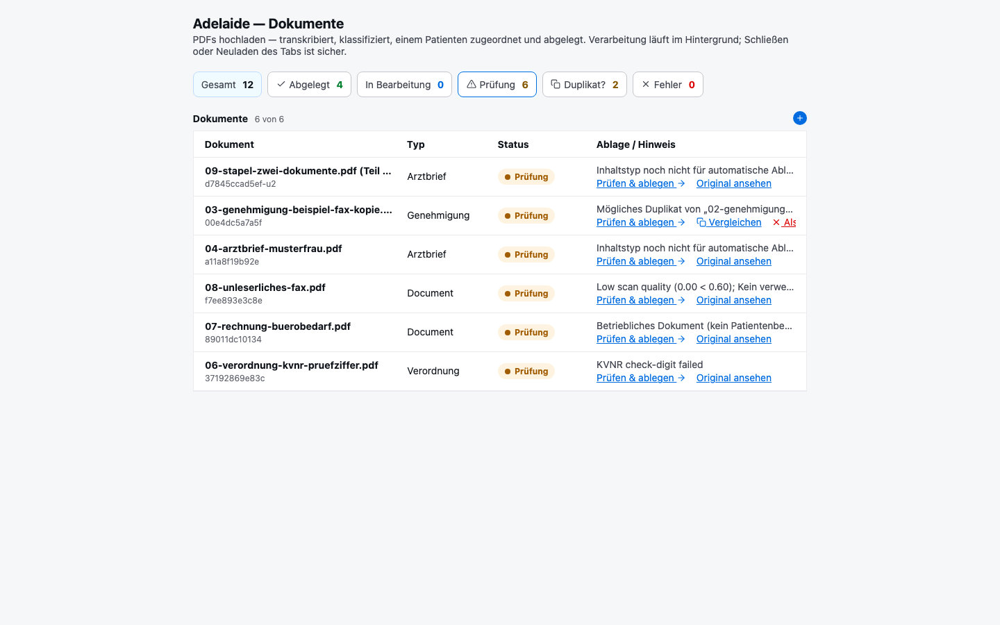
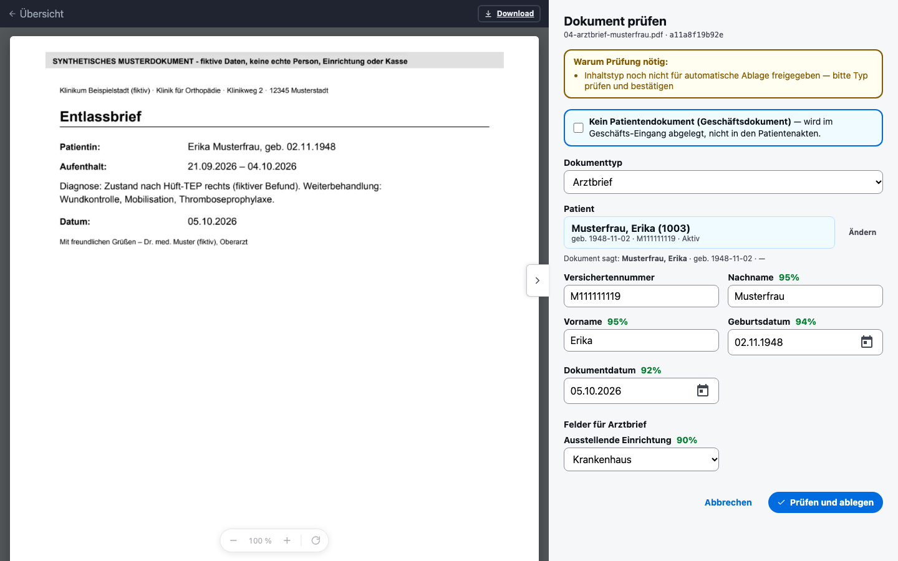
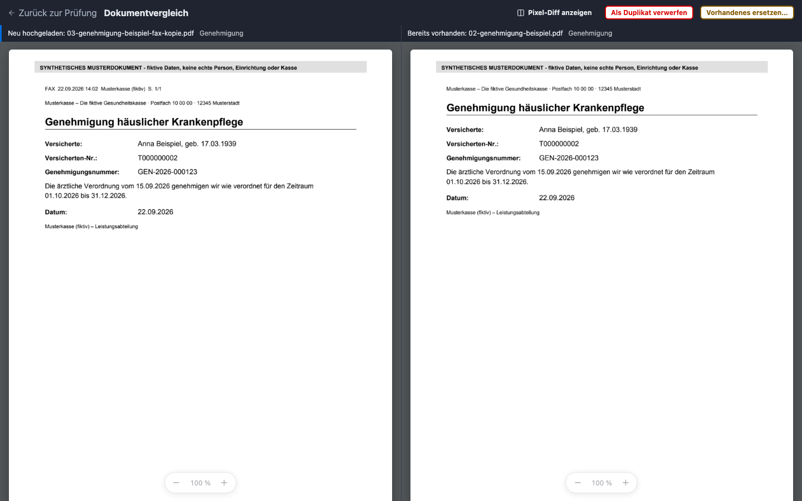
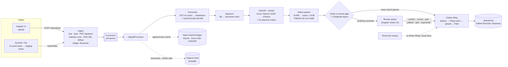

# Adelaide — AI-assisted medical document intake

Adelaide reads incoming scanned and faxed medical paperwork for a German home-care provider. It identifies which patient
each document belongs to and what kind of document it is. It files the document into SharePoint with the right metadata,
and routes anything it cannot verify to a human reviewer instead of guessing.

I designed, built and run Adelaide as an **internally deployed production system** for my own home-care business
(about 120 patients). This repository is a **public, sanitised version** of that codebase. It keeps the real engineering:
the pipeline, verification gate, ledger, outbox, review UI and test suites. Production integrations, organisation details
and all real data have been removed or replaced. It runs locally in a **demo mode** on an entirely fictional document set.

> **What this repository is and isn't**
> - The application code is the production code, minus removals listed in [docs/public-release.md](docs/public-release.md).
> - The demo does **not** call OCR or an LLM. It replays pre-recorded results for synthetic PDFs. Everything downstream
>   runs unchanged: KVNR validation, patient matching, the gate, duplicate detection, the ledger, filing and review.
> - Nothing in this repository is deployed anywhere, and there is no hosted demo.

---

## The problem

A home-care provider receives a steady stream of paper:
- physician orders for home nursing (*Verordnung häuslicher Krankenpflege*, Muster 12);
- insurer approvals (*Genehmigungen*);
- hospital discharge letters, lab reports and medication plans;
- care-level assessments and notices;
- signed contracts and powers of attorney.

Most of it arrives by fax or scanner. Before Adelaide, staff opened each document, worked out who it belonged to, typed
the metadata, renamed it and filed it into the right SharePoint library.

The cost is not only time. Filing a document to the **wrong patient** is a GDPR Art. 9 incident (health data). A missed
or mis-dated prescription has direct operational and billing consequences. The design goal was therefore stated as:

> **Never lose a document, and never be silently wrong.** Clean documents file themselves; anything unverifiable goes
> to a human, with the reason stated.

The operational estimate is that Adelaide saves the administrative team **about two hours of work per day**. This is
my own estimate from day-to-day operation, not an independently measured benchmark.

## What the production system does

- **Intake.** It takes browser uploads plus a scanner/fax channel: an on-prem drain pushes files to an Azure Files
  staging share, which the app polls. Each upload gets size, type and PDF-signature checks and optional ClamAV
  scanning. A SHA-256 duplicate check runs *before* any AI cost is spent.
- **Transcription.** Pages are rendered and sent to **Azure OpenAI GPT-4o vision** with a transcribe-only prompt
  (Markdown output plus a legibility score). Barcodes are decoded locally with zxing-cpp: the Muster 12 BFB PDF417 and
  the BMP medication-plan DataMatrix, which carry the patient's insurance number deterministically.
- **Classification and extraction.** Azure OpenAI with forced JSON schemas assigns one of 16 document types and fills
  that type's fields, each with its own confidence and provenance. A classification self-check flags the model when it
  disagrees with itself. **Azure AI Document Intelligence** layout analysis reads checkbox selection marks (first vs
  follow-up prescription).
- **Patient matching.** It matches against the SharePoint *Patients* list, a replica of the care-management system's
  patient master data, via Microsoft Graph. A check-digit-validated insurance number (KVNR) is tried first, then
  surname plus date of birth. Only a single *active* hit counts as a match.
- **Verify-or-review gate.** This deterministic, unit-tested rule set decides auto-file versus review. Auto-filing is
  deny-by-default and allowed per document type.
- **Duplicate detection** runs in three layers: exact bytes, a business key (patient + type + date + period), and a
  normalised-text fingerprint for non-patient documents.
- **Filing.** Document Intelligence produces a searchable PDF/A rendition, which is uploaded to SharePoint with the
  content type, patient lookup and metadata columns. Filing goes through an **outbox** that a reconcile sweep can
  complete after a crash.
- **Human review.** An Angular review screen sits next to the page viewer. The reviewer can confirm or correct fields,
  pick between candidate patients, rotate pages, split a multi-document scan, compare suspected duplicates side by side,
  supersede an earlier filing, or route a non-patient document to a separate business library.
- **Audit.** An append-only, SHA-256 hash-chained event ledger lives in SQLite locally and in Azure SQL `LEDGER` tables
  in the cloud. Structural metadata only goes on the chain; transcripts and model I/O live in a separate, erasable
  capture store.
- **Production deployment** (infrastructure-as-code not included): a container on Azure App Service with Entra ID
  (Easy Auth, app roles Reviewer/Admin), Azure SQL, Key Vault, Application Insights and EU-region AI services.

The UI and the reviewer-facing reason texts are in German; the code, logs and documentation are in English.

### Screenshots (demo mode, synthetic data)

| Intake dashboard | Review: patient pre-selected from name + date of birth |
|---|---|
|  |  |

**Duplicate compare:** a fax copy (left) flagged against the already-filed original (right) by business key:



## Architecture



| Project | Responsibility |
|---|---|
| [`src/Adelaide.Core`](src/Adelaide.Core) | Domain model, pipeline seams (`ITranscriber`, `IExtractor`, `IPatientDirectory`, `IDocumentSink`), the verify-or-review gate, KVNR validation and repair, patient-matching strategy, document catalog, barcode payload parsers (BFB/BMP), duplicate fingerprints, PHI redaction. No I/O. |
| [`src/Adelaide.Ai`](src/Adelaide.Ai) | Azure OpenAI client and extractor, GPT-4o vision transcriber, Document Intelligence (searchable PDF, layout), PDF rendering (PDFium/Skia), zxing-cpp barcode scanning, lossless page operations. |
| [`src/Adelaide.SharePoint`](src/Adelaide.SharePoint) | Microsoft Graph adapters: the SharePoint filer (`IFiler` / `IFiledDocumentStore`) and the patient directory. |
| [`src/Adelaide.Audit`](src/Adelaide.Audit) | Hash-chained ledger (`SqliteAuditStore`, `AzureSqlAuditStore`), capture store (transcripts, model calls, evaluation corpus). |
| [`src/Adelaide.Web`](src/Adelaide.Web) | ASP.NET Core host: HTTP API, auth policies, rate limiting, security headers, upload processor, outbox and reconcile sweep, drain poller. |
| [`src/Adelaide.Web.Client`](src/Adelaide.Web.Client) | Angular 22 + Material review UI: dashboard, review screen with page viewer, duplicate compare. |
| [`src/Adelaide.Demo`](src/Adelaide.Demo) | *Public repo only.* Local, offline stand-ins for the four external seams, used by demo mode. |
| [`src/Adelaide.Drain`](src/Adelaide.Drain) | On-prem scanner drain: staging share → authenticated `/api/drain/upload`, with ledger-after-ack. |
| [`src/Adelaide.Worker`](src/Adelaide.Worker) | Developer CLI: offline pipeline demo, diagnostics, chain verification. |
| [`tools/`](tools) | SQLite → Azure SQL ledger migrator (with chain verification), classifier evaluation from the ledger, Linux native-load smoke test, synthetic demo-corpus generator. |

More detail: [docs/architecture.md](docs/architecture.md) · [docs/pipeline.md](docs/pipeline.md)

## The pipeline, stage by stage

This is the production path in `UploadProcessor.ProcessAsync` ([Program.cs](src/Adelaide.Web/Program.cs)). The full
walkthrough with code pointers is in [docs/pipeline.md](docs/pipeline.md).

1. **Receive.** Bytes are captured to the intake store, hashed and recorded as `Received`, before any AI cost.
   Byte-identical re-sends are held as `DuplicateSuspect` for a human.
2. **Transcribe.** GPT-4o vision produces per-page Markdown and a legibility score. Barcodes are decoded locally from
   the same rendered images.
3. **Segment.** The file becomes 1..N document units with replay-stable derivation keys. A reviewer can split a bundle
   later, and each child reuses its slice of the parent transcript.
4. **Extract.** The model classifies the document and extracts that type's fields with per-field confidence and
   provenance (barcode, vision, Document Intelligence). Barcode identity overrides vision.
5. **Match.** KVNR first, then surname plus date of birth. The result is `Single`, `None` or `Multiple`, and only
   `Single` can auto-file.
6. **Gate.** The verify-or-review rules (below). Every reason is recorded twice: as German prose for the reviewer and
   as a PHI-free machine code for logs and metrics.
7. **Deduplicate.** Exact SHA-256, then the business key, then the text fingerprint. Concurrent workers are serialised
   with non-blocking claims.
8. **File or review.** Auto-file runs through the outbox. Anything else writes a review sidecar and a `NeedsReview` event.

### Patient identification

Attribution is the one decision that must never be guessed, so the rules are deliberately conservative
([`PatientMatching`](src/Adelaide.Core/PatientMatching.cs), [`Kvnr`](src/Adelaide.Core/Kvnr.cs),
[`BarcodeIdentity`](src/Adelaide.Core/BarcodeIdentity.cs)):

- **The KVNR comes from the barcode when there is one.** A KVNR is trusted only from a *structural* parse of a KBV
  prescription or BMP medication-plan payload. A checksum-valid ten-character token inside some other barcode, such as
  a franking or routing code, never becomes a matching key.
- **Validate before lookup.** The KVNR's mod-10 check digit is verified before any query, so an OCR misread becomes
  "no match → review" rather than a different patient. `Kvnr.Repair` fixes exactly one known OCR failure: a leading
  letter read as a look-alike digit (`O`→`0`). It does so only when exactly one candidate letter produces a valid
  check digit.
- **Fall back to surname plus exact date of birth.** A valid KVNR that matches nobody is usually a directory data-entry
  error, so name and DOB are tried before giving up.
- **Use status to break ties, and nothing else.** Two hits resolve only if exactly one record is active. Otherwise the
  candidates go to the reviewer's picker, and nothing is guessed.
- **Measure extraction against ground truth.** At review time the model's identity fields are compared with the
  patient record the reviewer selected. [`IdentityAgreement`](src/Adelaide.Core/IdentityAgreement.cs) records only a
  structural description of any difference ("length 9→10", "letter→digit at 0"), never the values.

### Duplicate detection

| Layer | Signal | Catches | Where |
|---|---|---|---|
| 1 | SHA-256 of the bytes | the same file sent twice | at upload, before any AI spend; held as `DuplicateSuspect` |
| 2 | patient KVNR + content type + document date + validity period | the same document re-scanned, or faxed and then posted | after matching ([`BuildDuplicateKeyPrefix`](src/Adelaide.SharePoint/SharePointSink.cs)) |
| 3 | SHA-256 of normalised transcript text | re-scans of non-patient (business) documents | business lane only ([`BusinessDedup`](src/Adelaide.Core/BusinessDedup.cs)) |

A duplicate is **never auto-rejected**. It goes to review with a side-by-side compare view, and the reviewer decides:
discard, process anyway, or supersede the earlier filing. A supersede deletes the old SharePoint item through its own
outbox. Discards stay recoverable for a configurable window.

### Human-in-the-loop review

The gate ([`IntakePipeline.Decide`](src/Adelaide.Core/IntakePipeline.cs)) auto-files only when **every** check passes:

- the transcript is usable (legibility above threshold, not empty);
- the KVNR passes its check digit, and patient matching returned exactly one patient;
- identity and classification confidence (not metadata confidence) is at or above 0.80;
- the type is not the fallback type, and the classification self-check confirmed it;
- the content type is on the **auto-file allowlist**, which is deny-by-default (in production: physician orders and
  payer approvals). The allowlist overrides confidence, so a confidently *wrong* classification still goes to review;
- every required field is present, including conditional rules (for example, an approval number is required *unless*
  the outcome is a rejection);
- an uncertain first-vs-follow-up prescription checkbox was settled by the barcode or by agreeing Document Intelligence
  selection marks;
- the document date is not in the future (this catches confidently day/month-swapped dates).

Everything else lands in the review queue with every reason listed. Reviewer corrections are diffed against the model's
proposal and recorded as PHI-free signals: which fields changed, and with what provenance. That is the basis for
measuring extraction accuracy over time.

## Design decisions and trade-offs

- **GPT-4o vision over classic OCR, with guardrails.** On real faxes the vision model reads far better than extractive
  OCR, but it can hallucinate. The mitigation is structural, not prompt-only: identity comes from deterministic
  barcodes where they exist, check digits gate lookups, a deny-by-default allowlist and confidence gate sit in front of
  filing, and every transcript is captured for later evaluation. Document Intelligence remains in the loop where it is
  better: selection marks, the searchable PDF/A rendition, and an OCR fallback.
- **The append-only ledger versus GDPR erasure.** The tamper-evident chain holds only structural facts: states, reason
  codes, hashes and opaque ids. Transcripts, model inputs and outputs, and reviewer prose live in a separate capture
  store with retention and erasure endpoints. The ledger records a transcript's SHA-256, so it can prove *which* text
  was produced without containing it.
- **Effectively-once filing.** SharePoint uploads are idempotent PUTs to a document-unique path. Filing writes a
  deletable sidecar and an atomic `Filing` event *before* the upload. A crash at any point leaves a document the
  reconcile sweep can finish from intent. No document is dead-lettered with half-written state in SharePoint.
- **One filer process.** Filing claims are process-local, so the host takes a machine-wide mutex and refuses a second
  instance. Deploys become stop-then-start, a short restart gap traded for a simple single-filer invariant, until a
  durable lease replaces the in-process claim.
- **Role-based, not per-patient, authorisation.** One central intake team triages everything. Reviewer and Admin roles
  come from Entra app roles, with a fallback policy that secures every new endpoint by default. Per-site scoping is
  documented as the seam to add if teams are ever split.
- **PHI never reaches logs.** Log lines carry document ids and structural codes. [`Redact`](src/Adelaide.Core/Redact.cs)
  strips bodies from exception chains, and tests assert that event payloads and review diffs contain no PHI.
- **Native-interop safety.** zxing-cpp's .NET `ImageView` keeps a raw pointer into a managed buffer without pinning it.
  Under a compacting garbage collector this can crash, or decode a *different* image, which in this domain means a
  different patient's barcode. The scanner pins the buffer for the whole native call, and a banned-API analyzer
  ([`BannedSymbols.txt`](src/Adelaide.Ai/BannedSymbols.txt)) makes the unsafe constructor a compile error.

## Production versus this repository

| Area | Production | This public repository |
|---|---|---|
| Transcription and extraction | Azure OpenAI (GPT-4o vision, JSON-schema extraction) + Document Intelligence | Real adapter code included. **Demo mode** replays fixture results for synthetic PDFs. |
| Patient directory | SharePoint *Patients* list via Graph (mirrors the care-management system) | Real Graph adapter included. Demo: [`demo/patients.json`](demo/patients.json), 7 fictional patients. |
| Document storage | SharePoint libraries via Graph | Real filer included. Demo: a local folder tree (`.adelaide-demo/filed/`). |
| Searchable PDF/A | Document Intelligence rendition | Demo files the original PDF (the documented fallback path). |
| Ledger | Azure SQL `LEDGER` tables; digests anchored to immutable storage | Azure SQL store and schema included. Demo and tests use SQLite. |
| Auth | Entra ID Easy Auth, app roles | Same code. Demo uses the Development-only local identity. |
| Scanner drain and staging share | On-prem drain → Azure Files | Code included, inactive unless configured. |
| Infrastructure as code | Terraform for App Service, SQL, Key Vault, monitoring, networking | **Not included** (organisation-specific). |
| Real documents, patients, organisation details | — | **None.** All demo data is generated by [`tools/Adelaide.SampleGen`](tools/Adelaide.SampleGen). |

## Run it locally (demo mode)

**Prerequisites:** the [.NET 10 SDK](https://dotnet.microsoft.com/download) and Node.js 22 or newer with npm. No cloud
account or credentials are needed.

```bash
git clone https://github.com/philippschleier/adelaide-document-intake.git
cd adelaide-document-intake
scripts/run-demo.sh            # builds the Angular client on first run, then serves http://localhost:5080
```

Open <http://localhost:5080> and upload files from [`demo/samples/`](demo/samples). Each sample shows one behaviour:

| Sample | What happens |
|---|---|
| `01-verordnung-mustermann.pdf` | valid KVNR, single patient, allowlisted type → **auto-filed** |
| `02-genehmigung-beispiel.pdf` | payer approval → **auto-filed**; upload it again → **exact duplicate held** |
| `03-genehmigung-beispiel-fax-kopie.pdf` | same approval as a fax copy (different bytes) → **business-key duplicate → review + compare** |
| `04-arztbrief-musterfrau.pdf` | matched by name + DOB, type not allowlisted → **review**, patient pre-selected |
| `05-arztbrief-testfall-namensgleich.pdf` | two active patients share name and DOB → **review with both candidates** |
| `06-verordnung-kvnr-pruefziffer.pdf` | KVNR fails its check digit → never looked up; name + DOB finds the active record → **review** |
| `07-rechnung-buerobedarf.pdf` | invoice, no patient → **business lane** (reviewer picks a Zielbereich) |
| `08-unleserliches-fax.pdf` | "unreadable" scan → empty transcript → **review** |
| `09-stapel-zwei-dokumente.pdf` | two patients' documents in one scan → **review → split** → each child processed on its own |

Demo mode is a separate composition of the same host ([`DemoMode.cs`](src/Adelaide.Web/DemoMode.cs)):
- it **refuses to start** if any production setting is present;
- it **blocks all outbound HTTP and token acquisition**, the same block the HTTP test harness uses;
- it rebinds only the transcriber, extractor, patient directory and filer.

See [demo/README.md](demo/README.md) for details and `scripts/run-demo.sh --reset` to start over.

Also available offline: `dotnet run --project src/Adelaide.Worker` runs the pipeline orchestrator with stub adapters in
the console.

### Running against real services

Copy [`.env.example`](.env.example) to `.env` and fill in your own Entra app registration, SharePoint site,
Azure OpenAI and Document Intelligence endpoints. The SharePoint site needs the *Patient Records* library with the
content types in [`DocumentCatalog`](src/Adelaide.Core/DocumentCatalog.cs) and a *Patients* list with the columns in
[`GraphMapping`](src/Adelaide.SharePoint/GraphMapping.cs). Provisioning scripts and infrastructure code are not
included, so this path assumes you set those up yourself.

## Tests

```bash
dotnet test Adelaide.slnx                         # all .NET test projects
(cd src/Adelaide.Web.Client && npm ci && npm test -- --watch=false)
```

- **Core:** the gate rules, KVNR validation and repair, barcode parsers (BFB/BMP), matching, catalog and vocabulary
  invariants, PHI redaction.
- **Audit:** hash-chain integrity and replay determinism, sealed-append guards, and the store contracts. The SQL
  Server variant runs in CI against a throwaway container.
- **Web:** out-of-process **HTTP-surface tests**. A real `Adelaide.Web` child process runs on a loopback port with all
  outbound network blocked. The tests cover authorisation, CSRF, rate limits, upload limits, the error surface, the
  review state machine, outbox invariants and failure composition. **Demo-mode end-to-end tests** upload synthetic PDFs
  through the real host.
- **Demo:** pins every sample to its documented outcome through the real gate.
- **Client:** Vitest unit tests for the Angular helpers.

CI ([`.github/workflows`](.github/workflows)) runs:
- every .NET test project, including the SQL Server contract tests;
- a startup check that the durability guard actually fires;
- a native-library smoke test in the runtime image;
- the Angular build and tests;
- a Gitleaks secret scan.

## Configuration

All configuration is environment variables; [`.env.example`](.env.example) documents them. There are no built-in
tenant, site or endpoint defaults. A missing required setting fails at startup with the variable's name.

## Security and privacy

- No real patient data, credentials, tenant identifiers or organisation names are in this repository. The publication
  process is described in [docs/public-release.md](docs/public-release.md).
- Every demo document carries a "SYNTHETISCHES MUSTERDOKUMENT" banner. Names follow the conventional German
  placeholders (Mustermann, Musterfrau, Beispiel), and KVNRs are low-entropy synthetic values.
- `.gitignore` blocks PDFs, intake folders, databases, `.env` and run scripts by default. The only PDF exception is
  `demo/samples/`.
- See [SECURITY.md](SECURITY.md) for reporting issues.

## Notes for readers of the code

- Comments are dense and often explain *why*, including incidents that shaped a rule. Some comments refer to internal
  design documents (`docs/CAPTURE.md`, the migration plan, the splitting spec, "design §n") that are **not part of this
  public repository**.
- `Program.cs` in `Adelaide.Web` is a large minimal-API composition root. It grew with the system and is a known
  candidate for splitting into endpoint modules.

## License

Copyright © 2026 Philipp Schleier. **All rights reserved.** The source is published for review as part of a
professional portfolio; see [LICENSE](LICENSE). Third-party packages remain under their own licenses
([THIRD-PARTY-NOTICES.md](THIRD-PARTY-NOTICES.md)).
