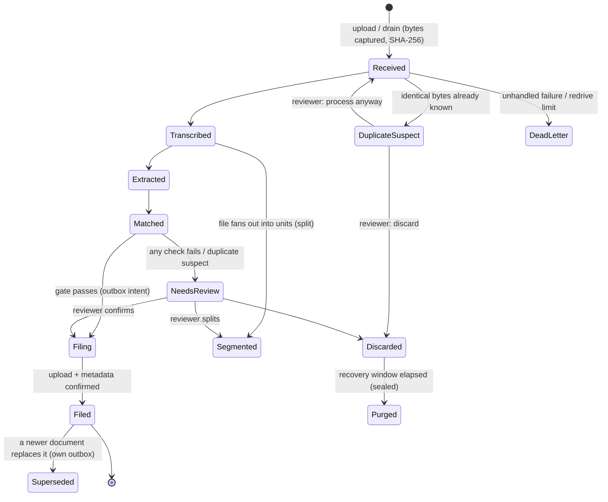

# Architecture

This document goes one level below the [README](../README.md): how a document moves through durable states, where
each kind of data lives and why, and the security controls at each boundary.

## Seams

Everything that talks to the outside world sits behind an interface in `Adelaide.Core` or `Adelaide.SharePoint`. The
orchestration, gate and ledger code never knows which implementation it has.

| Seam | Production | Demo mode | Tests |
|---|---|---|---|
| `ITranscriber` | `VisionTranscriber`: PDFium render → GPT-4o vision + local zxing-cpp barcodes | `DemoTranscriber`: fixture replay by SHA-256 | scenario stubs |
| `IExtractor` | `AzureOpenAiExtractor`: classify, self-check, schema extraction, barcode/selection-mark merge | `DemoExtractor` | scenario stubs |
| `IPatientDirectory`, `IPatientSearch` | `GraphPatientDirectory`: SharePoint *Patients* list | `DemoPatientDirectory`: `demo/patients.json` | in-memory |
| `IFiler`, `IFiledDocumentStore`, `IDocumentSink` | `SharePointSink`: Graph upload, content type, columns, Volltext | `LocalFolderFiler` | `NullFiler` / fault-injecting filers |
| `IPdfTextLayer` | `DocIntelligencePdf`: prebuilt-read → searchable PDF/A | `NoTextLayer` (original filed) | — |
| `IAuditStore` | `AzureSqlAuditStore` (`LEDGER` tables) | `SqliteAuditStore` | `SqliteAuditStore` |
| `ITranscriptStore` | `AzureSqlTranscriptStore` | `TranscriptStore` (SQLite) | both, via a shared contract suite |

Both matching backends use the same strategy, `PatientMatching.MatchAsync`, so the demo cannot drift from production
matching semantics. Backends supply only the two lookups (exact KVNR, exact surname).

## Document lifecycle

Every document is always in exactly one state, and the state is derived from the newest event in the ledger. Events
are appended. Nothing is updated in place.

`Settled` states ([`DocumentStates`](../src/Adelaide.Core/DocumentStates.cs)) are terminal for every query, re-entry
guard and sweep. `Purged` is *sealed*, meaning the store refuses any further append for that document.

## Durability: "never lose a document"

The principle is that at every moment exactly one durable holder owns the document. Ownership moves only after the
next holder has committed.

- **Capture first.** Upload bytes are written to the intake store and recorded as `Received` before the request
  returns. Everything later can be re-driven from those bytes.
- **Outbox filing.** Before the SharePoint upload, the processor writes a deletable *filing sidecar* containing the
  full spec (filename, content type, fields, search text, target drive) and appends a `Filing` event. The upload is an
  idempotent PUT to a document-unique path. If the process dies anywhere between `Filing` and `Filed`, the
  **reconcile sweep** re-drives the recorded spec to the same destination. Supersede, reclassify, rotate and split
  each have their own intent-plus-reconcile pair.
- **Verify before delete.** The local copy of a filed PDF is deleted only after SharePoint confirms the item exists *by
  its id, in the drive it was recorded in*. A grace window keeps arrival bytes for misfile repair. An operator
  kill-switch ([`PurgeGate`](../src/Adelaide.Web/PurgeGate.cs)) stops every deletion path; it fails closed.
- **Bounded retries.** Processing attempts are durable pickup marks. A document that kills the worker repeatedly is
  parked as `DeadLetter` after a configurable number of attempts, rather than looping forever. A stall gauge on `/api/stats`
  counts machine-owned documents that have stopped advancing, next to the reconcile sweep's heartbeat.
- **One filer.** A machine-wide mutex refuses a second web host, because filing claims are process-local. Test and
  demo hosts take differently named mutexes, so they can never contend with a real instance.

## Data placement

| Data | Where | Why |
|---|---|---|
| Event history (state, actor, reason **codes**, SHA-256s, opaque ids) | Hash-chained ledger: `events` + `documents` projection | Tamper-evident and append-only. Holds **structural** facts only, because it cannot be erased. |
| Reviewer-facing reason **prose**, filenames | Erasable projection columns | Prose can contain a filename, which can contain a KVNR. |
| Transcripts, page slices, barcode payloads, model request/response bodies | Capture store (separate DB or schema) | PHI. Subject to retention and per-document erasure (`/api/capture/erase`). |
| Evaluation corpus (labels, confidences, provenance) | Capture store `corpus` tables | Lets classification and extraction accuracy be measured offline from human review outcomes. |
| PDFs | Intake store until filed and verified; then SharePoint | Single durable owner at any time. |

The chain is verifiable end to end through `/api/audit/verify` (and `Worker verify-chain`). In production the Azure SQL
ledger's database digests are also exported to immutable storage, so a rollback of the database itself would be
detectable.

## Security controls

- **Authentication.** App Service Easy Auth with Entra ID. The handler can additionally *cryptographically validate*
  the forwarded ID token (JWKS, issuer, audience, lifetime), so a forged principal header is worthless even without
  the platform in front. Machine intake (the drain) uses a separate JWT bearer scheme with an app-only role.
- **Authorisation.** A fallback policy requires a Reviewer or Admin role on every endpoint that does not opt out.
  Destructive operator actions require Admin. Mutations stamp the actor's Entra object id, never an email address, and
  are refused if there is no authenticated actor.
- **Request hardening.** Every mutating endpoint requires a CSRF header (`X-Requested-With`). Rate limiting has
  separate budgets for expensive (AI-driving) and read endpoints. Upload size, count and PDF-signature checks run
  before anything touches the native PDF engine. ClamAV scanning is optional and fails closed when configured.
- **Response hardening.** Strict CSP, `nosniff`, `X-Frame-Options: DENY`, `Referrer-Policy: no-referrer` and HSTS
  outside Development. The headers are applied via `OnStarting`, so they survive an unhandled-exception 500.
- **Container.** The container runs as the non-root `$APP_UID`, with read-only app binaries. A host started *in a
  container* with a file-path capture store fails at startup by name (`CaptureDurabilityException`), because container
  disk is ephemeral. CI boots the host to prove that guard fires.
- **PHI hygiene.** No PHI in logs or telemetry. Tests check event payloads, review diffs and capture boundaries for
  stray values. The test HTTP harness runs the real host with every outbound socket and token request blocked.
